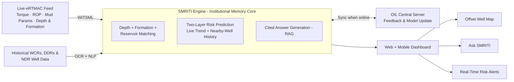

<div align="center">

# 🛢️ SMRITI
### Subsurface Memory & Risk Intelligence Tool

**An AI-powered offset well knowledge and decision-support platform for drilling operations**

*eRTMAC-NWIS (Nearby Wells Intelligence System)*


</div>

---

## 📌 Hackathon Details

| Field | Details |
|---|---|
| **Hackathon** | Smart India Hackathon 2026 |
| **Problem Statement ID** | 26121 |
| **Problem Statement Title** | eRTMAC-NWIS (Nearby Wells Intelligence System): An AI-Powered Offset Well Knowledge and Decision Support Platform for Drilling Operations |
| **Organization** | Oil India Limited |
| **Theme** | Smart Automation |
| **Category** | Software |
| **Team Name** | Genius Grid |
| **Team ID** | 126081 |

---

## 📖 Overview

SMRITI reads **Well Completion Reports (WCRs)** and **Daily Drilling Reports (DDRs)** from wells near an active drilling site, understands what happened at each depth and formation, and **warns the current crew before a past problem repeats.**

Drilling decisions in geologically complex formations need more than real-time data from the active well. They also need lessons from nearby and historical wells. Today, that knowledge is scattered across scanned reports, PDFs, databases, and the memory of individual engineers. SMRITI turns it into a searchable, map-based, alert-generating **institutional memory** that sits alongside Oil India's existing eRTMAC monitoring system.

---

## ❗ Problem

Drilling teams currently lack a unified platform that can:

1. Display nearby wells on a geospatial map relative to the active well.
2. Give instant access to historical drilling experience and events from offset wells.
3. Correlate drilling parameters, reservoir characteristics, mud losses, kicks, stuck pipe, casing, cementing, and formation-specific risks across wells.
4. Alert the crew when current operations approach depths or formations where similar problems occurred nearby.

As a result, engineers spend significant time manually searching reports, which slows decisions and lets avoidable risks slip through.

---

## ✨ Key Features

| Feature | Description |
|---|---|
| 🗺️ **Interactive Offset Well Map** | Shows every nearby well within a user-defined radius, colour-coded by its past drilling risk. |
| 🧠 **Institutional Memory Engine** | Converts old drilling reports into searchable events tagged by depth and formation using OCR and NLP. |
| 💬 **Ask SMRITI** | Answers plain-language questions using real historical reports and always shows the source. |
| 🚨 **Proactive Risk Alerts** | Warns the crew about stuck pipe, kicks, and mud-loss zones before the bit reaches that depth. |
| 📡 **Live Feed Correlation** | Checks live eRTMAC data against nearby-well history automatically. |
| 📴 **Offline Resilience** | Core well history is cached locally so remote wellsites still get answers when connectivity drops. |

---

## 💡 Innovation and Uniqueness

- **Depth, Formation, Reservoir & Distance Matching:** ranks nearby wells by geology first, not by text similarity alone.
- **Reads raw scanned reports directly:** extracts usable cases straight from scanned WCRs and DDRs via OCR + NLP, with no manually built case library required.
- **Cited, confidence-scored answers:** every answer names its exact source report, so nothing is guessed or invented.
- **Open, sovereign technology stack:** runs inside a company's own infrastructure, with no dependency on paid foreign vendor software.

---

## 🏗️ System Architecture



### Workflow

1. **Reading old reports:** PaddleOCR reads scanned WCRs and DDRs. spaCy extracts depth, formation, incident, and fix. MongoDB Atlas stores each event with its well location.
2. **Matching and alerting:** live eRTMAC data arrives via WITSML. Atlas Vector Search finds similar past cases. XGBoost scores risk from live trends and nearby-well history. An LLM writes an alert that names its source report (RAG).
3. **Showing it on the map:** React displays nearby wells on a Leaflet.js map. Turf.js keeps only the wells inside the chosen radius. Engineer feedback on each alert improves later matches.

---

## 🧰 Tech Stack

| Layer | Technology |
|---|---|
| **OCR** | PaddleOCR |
| **NLP / Information Extraction** | spaCy |
| **Database & Vector Search** | MongoDB Atlas, Atlas Vector Search |
| **Risk Prediction** | XGBoost |
| **Answer Generation** | Retrieval-Augmented Generation (RAG) |
| **Rig Data Standard** | WITSML (Energistics) |
| **Geospatial** | Leaflet.js, Turf.js |
| **Frontend** | React |
| **Backend** | Node.js, Express |

---

## 🎯 Problem Statement Coverage

| Expected Outcome | How SMRITI Addresses It |
|---|---|
| Extract and structure information from historical reports | PaddleOCR + spaCy pipeline |
| Map of nearby wells within a user-defined radius | Leaflet.js + Turf.js radius filtering |
| Searchable repository of events and lessons learned | MongoDB Atlas + Vector Search |
| Correlate data across wells by depth and formation | Depth + Formation + Reservoir Matching |
| Predictive models for drilling risks | XGBoost two-layer risk prediction |
| Real-time alerts and recommendations | Live WITSML feed + RAG-generated alerts |
| User-friendly dashboard for field and office staff | React web + mobile view |

---

## ⚠️ Challenges and Mitigation

| Challenge | Strategy |
|---|---|
| Old reports are scanned, faded, or handwritten | Flag low-confidence OCR results for manual review; start with recent digital reports and expand backward. |
| Engineers may hesitate to trust AI alerts during live drilling | Every alert shows its exact source report and a confidence score. SMRITI supports the driller's decision and never overrides it. |
| Drilling data is a sensitive national asset | Runs inside the company's own network with role-based access, not a public foreign cloud. |

---

## 🌍 Impact

- **Social:** a retiring engineer's field experience stays with the organisation.
- **Economic:** less time lost to manual report searching and fewer repeat drilling failures.
- **Environmental:** fewer mud-loss and stuck-pipe events mean less waste and fewer incidents.
- **Safety:** earlier warning on kick- and blowout-prone zones supports safer rig-floor decisions.
- **National Legacy:** preserves decades of drilling history as an active national asset.

**Target users:** drilling engineers and real-time monitoring staff (primary); geologists, reservoir engineers, and HSE teams (secondary); regulatory bodies and other Indian E&P operators (emerging).

---

## 🗂️ Repository Status

This repository accompanies our SIH 2026 idea submission. The prototype is under active development; this README documents the concept, architecture, and approach.

```
smriti-nwis/
└── README.md
```

---

## 🛣️ Roadmap

- [x] Problem analysis and solution design
- [x] Architecture and technology selection
- [ ] OCR + NLP pipeline for WCRs and DDRs
- [ ] Event store and vector search on MongoDB Atlas
- [ ] Offset well map with radius filtering
- [ ] Ask SMRITI (cited RAG search)
- [ ] XGBoost risk prediction models
- [ ] Live WITSML feed integration and alerting
- [ ] Engineer feedback loop and model updates
- [ ] Offline caching for remote wellsites

---

## 📚 References

**Government & Industry Data Sources**
- Directorate General of Hydrocarbons, National Data Repository (NDR): [ndr.dghindia.gov.in](https://ndr.dghindia.gov.in)
- Oil India Limited: [oil-india.com](https://www.oil-india.com)
- Energistics, WITSML Data Standard: [energistics.org](https://energistics.org)

**Drilling Risk Prediction & Real-Time Analytics**
- SPE Journal (2025), *"Review of Stuck Pipe Prediction Methods and Future Directions"*
- Zeng, Z., Su, K., Liao, Y. et al., *"Stuck Pipe Anomaly Early Warning Model Based on Improved Random Forest Algorithms,"* Oil Drilling & Production Technology, 2025, 47(5): 632–645

---

<div align="center">

**SMRITI: so that every well drilled teaches the next one.**

</div>
